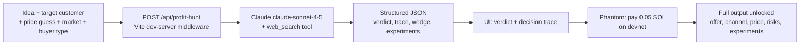

# ProfitHunter

An AI agent that turns a vague startup idea into a paid demand test: it researches the market, picks the most sellable product wedge, and proves validation with a small buyer payment on Solana. Built for hackathon founders who need a "would anyone pay?" signal in 48 hours.


<!-- screenshot: add docs/screenshot.png -->

## What it does

- **Researches your idea live**: Claude runs up to 4 web searches on competitors, prices and existing spend.
- **Gives an honest verdict**: "Worth testing", "Weak signal - pivot recommended" or "Do not pursue as written". Weak ideas get an improved replacement, not just a rejection.
- **Shows its reasoning**: a 4-step decision trace (ICP, offer format, price, channel), each with a 0–100 confidence score and the evidence behind it.
- **Picks a concrete offer**: winning wedge, primary channel, a real price (never "TBD"), top reasons, risks and a 48-hour task list.
- **Ranks experiments**: three alternative wedges, each with a buyer segment, price and 0–100 monetization score.
- **Validates with money**: the full output unlocks after a 0.05 SOL deposit sent from a Phantom wallet on Solana devnet.

## How it works



The Anthropic call happens server-side inside a small Vite plugin (`vite.config.ts`), so your API key never reaches the browser.

## Quickstart

Requires Node.js 20.19+ (Vite 7), an [Anthropic API key](https://console.anthropic.com/), and the [Phantom](https://phantom.app/) browser extension switched to **devnet** with some devnet SOL (from a Solana devnet faucet).

```bash
git clone https://github.com/0jz/ProfitHunter.git
cd ProfitHunter
npm install
cp .env.example .env        # Windows cmd: copy .env.example .env
# edit .env and set ANTHROPIC_API_KEY=<your-anthropic-key>
npm run dev
```

Open http://127.0.0.1:5173 (Vite's default port; the terminal prints the exact URL).

## Configuration

| Variable | Required | Default | Description |
|----------|----------|---------|-------------|
| `ANTHROPIC_API_KEY` | Yes | – | Anthropic API key, read by the dev-server API route |

Hard-coded in source (edit to change):

| Setting | Value | Where |
|---------|-------|-------|
| Model | `claude-sonnet-4-5`, `max_tokens` 3200, web search `max_uses` 4 | `vite.config.ts` |
| Payment amount | `0.05` SOL | `PAYMENT_SOL` in `src/main.tsx` |
| Recipient wallet | `7f7Gqo2rCMXSRdeqR7spLkx8vS9U6YLH1KH6xTVBrmEL` | `RECIPIENT_WALLET` in `src/main.tsx` |
| Network | Solana devnet (`https://api.devnet.solana.com`) | `src/main.tsx` |

## Usage

1. Fill in the form:

   | Field | Notes |
   |-------|-------|
   | Startup idea | Required |
   | Target customer | Optional |
   | Price guess | Optional, e.g. `$29/mo or 0.05 SOL deposit` |
   | Market | US/EU English-speaking (default) · Serbia and Balkans · Global |
   | Buyer type | B2B buyer (default) · Creator / solo maker · Consumer |

2. Run the analysis and read the verdict and decision trace.
3. Click **Connect wallet**, then **Pay 0.05 SOL with Phantom** and approve in Phantom.
4. After devnet confirmation, the offer, channel, pricing reason, risks and experiments are revealed, with a link to the transaction on Solana Explorer.

### API

`POST /api/profit-hunt` with JSON `{ idea, targetCustomer, priceGuess, market, buyerType }` returns `{ result }` (the parsed JSON) or `{ error }`. It is only available while `npm run dev` is running.

## Project structure

```
vite.config.ts    # Vite config + profit-hunt API middleware: prompt, Claude call, JSON parsing
src/main.tsx      # Whole React app: form, results, Phantom connect + Solana payment
src/styles.css    # Styles
index.html        # Vite entry
brand.md          # Brand setup note (deferred; neutral styling for now)
.env.example      # Env template
```

## Status & limitations

- Hackathon prototype. Payments run on **devnet only** (no real money).
- The API route lives in the Vite **dev server**. `npm run build` / `npm run preview` produce a static site with no `/api/profit-hunt`, so you need a real backend before deploying.
- The "unlock" is client-side state: the payment proves intent, but it doesn't securely gate data (the full result is already in the browser).
- Only the Phantom wallet (`window.solana`) is supported. Some wallet error messages are in Serbian.
- Output quality depends on Claude and on what web search finds. Treat scores as estimates.
- No tests or linter are configured.

## License

No license file is included yet. Until one is added, all rights are reserved by the author.
